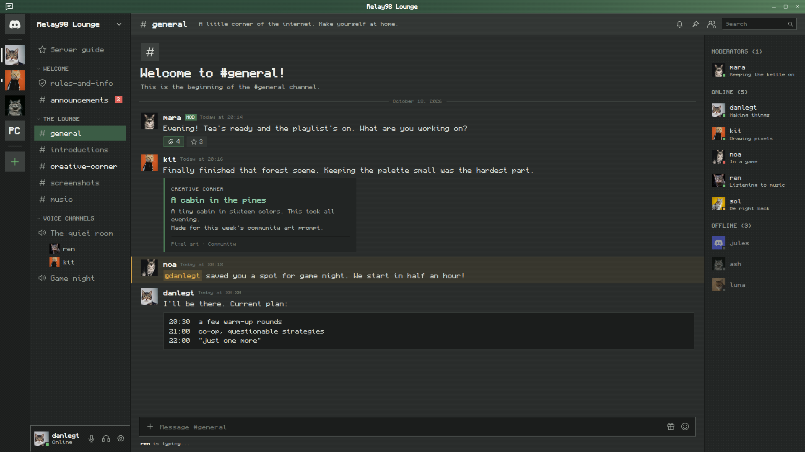
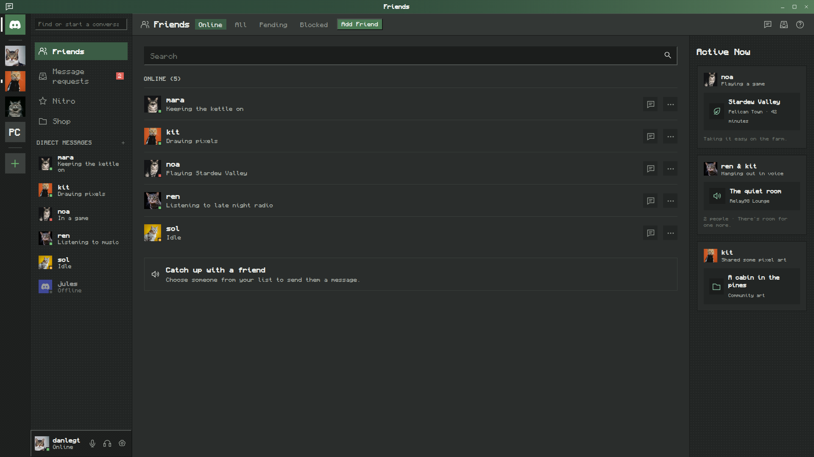
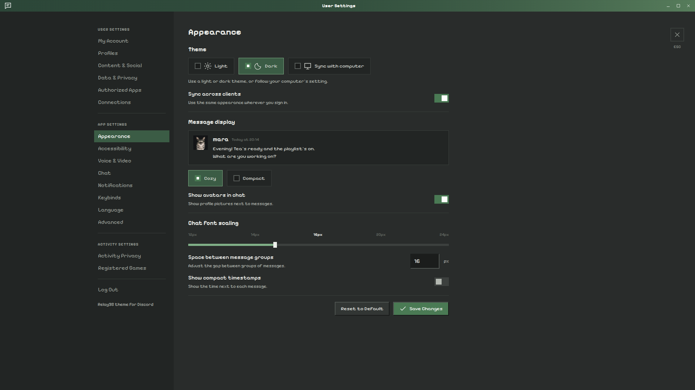

# Relay98

A dark Discord theme for Vesktop and BetterDiscord, with pixel fonts and retro window styling.

The layout takes cues from [system24](https://github.com/refact0r/system24).





## Install

1. Download `relay98.theme.css` from the [latest release](https://github.com/danlegt/Relay98/releases/latest), or build it using the commands below.
2. Copy the file into your themes folder and enable it:
   - Vesktop: Settings → Vesktop Settings → Themes → open the themes folder.
   - BetterDiscord: Settings → Themes → open the themes folder.
3. Reload Discord (Ctrl+R).

## Build

Use Node.js 20 or newer and npm. The CSS build needs no extra packages.

```sh
npm run build   # builds build/relay98.theme.css once
npm run dev     # rebuilds automatically when files in src/ change
```

## Customize your theme

Download or clone the repo, then open [customize.html](customize.html) in your browser. You don't need a server.

1. Pick an accent and adjust the settings. Pine is the default. The ten alternatives include 2004, with classic Steam olive and mustard colours. Under Effects, you can toggle each pattern.
2. Use the tabs above the preview to switch between Discord (chat, friends) and Spotifast (home, liked songs).
3. Run the copied build command in the Relay98 folder, then install `build/relay98-custom.theme.css`. Enable Relay98 Custom and disable the original.

The command works in Bash, PowerShell and Command Prompt without extra escaping. It includes your settings and leaves the source files and `build/relay98.theme.css` unchanged.

Check panel sizes in Discord; the preview uses a sample layout. The editor makes no external requests. Install custom fonts on your computer. The Google Fonts switch controls whether the built theme loads Pixelify Sans and VT323 from Google.

The Spotifast preview matches the export colours. For optional album covers, see [demos/images/spotifast/](demos/images/spotifast/README.md).

Your browser saves the last valid settings. Save downloads the full setup, including fonts and spacing; Load restores it. You can also build from that file:

```sh
npm run build -- --config relay98-settings.json
npm run build -- --config relay98-settings.json --output build/my-theme.theme.css
npm run dev -- --config relay98-settings.json
```

The last command watches the CSS source and settings file. If a rebuild fails, you keep the last working CSS file.

Omitted fields use the defaults. For Diskette with larger text and system fonts:

```json
{
  "palette": "diskette",
  "sizes": { "fontSize": 18, "codeSize": 16 },
  "fonts": {
    "ui": "system-ui, Arial, sans-serif",
    "code": "Consolas, monospace"
  },
  "effects": { "scanlines": false, "dots": false },
  "googleFonts": false
}
```

Effect switches are `scanlines`, `dots`, `dither`, `stripes`, `scrollbar`, `bevels` and `shadows`. Older settings with `"textures": false` turn all patterns off. Use six-digit hex colours and whole-pixel sizes within the editor's ranges. The build rejects invalid values and unknown options. Run `npm run build -- --help` for command-line options.

## Theme versions

Install `build/relay98.theme.css` for the original theme, or [build/relay98-discord-dark.theme.css](build/relay98-discord-dark.theme.css) for darker panels and round avatars. The latter appears as Relay98 Discord Dark. Enable one Relay98 theme at a time.

```sh
npm run build -- --variant discord
npm run build -- --variant discord --format spotifast
```

Accent changes colours and keeps your other settings. Change avatar shapes under Layout > Avatars; panel corners stay separate. You can load older settings, including Discord Dark. After you choose an accent, the build uses the name Relay98 Custom.

To add an accent, edit `palettes` in `scripts/customization.js` and list its ID in `paletteOptions`. The JSON field is still `palette`; legacy IDs and `--variant` still work.

## Spotifast theme

Use [build/relay98.spotifast.json](build/relay98.spotifast.json) for Pine, or click Spotifast theme in `customize.html` to export your colours.

From the command line:

```sh
npm run build -- --format spotifast
npm run build -- --format spotifast --config relay98-settings.json
npm run dev -- --format spotifast --config relay98-settings.json
```

The output is `build/relay98.spotifast.json`, or `build/relay98-custom.spotifast.json` with settings. You can append `--format spotifast` to the editor's command. To choose a filename, add `--output build/my-spotifast.json`.

1. In Spotifast, go to Settings > Appearance > Theme and click Open themes folder.
2. Copy the `.json` file into that folder.
3. If Spotifast is open, run `spotifast reload-themes`, then select the filename in the Theme picker. On Linux, Spotifast detects file changes.
4. Turn off Colour from album art to use your chosen palette on all pages.

The export uses [Spotifast's theme format](https://spotifast.rocks/settings-and-files/#custom-themes) to colour the main window. It keeps Spotifast's fonts and layout. Winamp skins use a separate format.

## Reuse the palette

Click Palette JSON in the editor, or run:

```sh
npm run build -- --format palette
npm run build -- --format palette --config relay98-settings.json
```

The output is `build/relay98.palette.json`, or `build/relay98-custom.palette.json` with settings. It includes all shades under plain names such as `background`, `panel`, `text`, `accent`, and `success`, without app settings. The `colors` object uses `#RRGGBB`, with an alpha byte for overlays, shadows and tints. The background determines the `base` (`dark` or `light`).

Both JSON exports use the same palette and light/dark base. Button labels account for contrast in normal and hover states. Overlay and shadow colours follow your input and bevel shades.

Use palette exports in other apps. To continue editing in Relay98, use Save and Load.

## Screenshots

```sh
npm run screenshot
```

The command rebuilds the standard theme and captures the three demos with [Playwright and Chromium](https://playwright.dev/docs/library). It replaces `assets/chat.png`, `assets/friends.png`, and `assets/settings.png` with `1920`×`1080` screenshots.

Use Node.js 20 or newer. The first run needs internet access to download Playwright into `demos/node_modules/` and Chromium into `.tools/chromium/`. Git ignores both folders. Later runs use the repo's cat photos and fonts without external requests. Set `CHROMIUM_BIN=/path/to/chromium` to use an existing browser.

Open `demos/chat.html`, `demos/friends.html`, or `demos/settings.html` in your browser to view the built theme. Use `?theme=...` for another CSS URL; screenshot scripts can wait for `window.demoReady`. See `demos/images/` for photo credits and `demos/fonts/` for font licenses.

For a custom build, open `demos/chat.html?theme=../build/relay98-custom.theme.css`.

## Checks

```sh
npm test             # build, settings validation, and demo-loader regressions
npm run test:browser  # customizer interactions and compiled CSS in Chromium
```

Browser checks share the screenshot tools and test the editor, build command and demos. They leave the README pictures unchanged.

The unit tests need Bash. GitHub Actions runs them on Node.js 20 and 24 and checks the committed CSS and JSON exports. Releases run the tests, then build the CSS variants and JSON exports.

## Structure

```
src/
  00-variables.css   palette + fonts, mapped onto every Discord color token
  10-layout.css      per-area patterns, title bars, panel lines, selection, menus, tooltips
  20-components.css  beveled buttons, sunken inputs, code blocks, scrollbars
scripts/build.js     concatenates src/*.css (in filename order) into build/relay98.theme.css
scripts/customization.js  shared settings, presets, and validation for the page and build
scripts/screenshot.js  optional local screenshot command
scripts/test-browser.js  browser checks for the customizer and demo pages
customize.html       local theme customizer and build-command generator
customize.css        editor layout plus the Discord and Spotifast previews
customize.js         controls, preview tabs, saved settings, and command copying
build/relay98.theme.css  the actual file you install
build/relay98.spotifast.json  matching Spotifast colour palette
build/relay98.palette.json  colours for use in other projects
demos/               three static Discord views for screenshots, plus shared layout and loader
assets/              generated 1920 × 1080 PNGs used above
```

Edit `--r98-*` in `src/00-variables.css` for theme defaults, and `scripts/customization.js` for editor presets and allowed settings.

## Fonts

Relay98 uses [Monocraft](https://github.com/IdreesInc/Monocraft) for interface text and code if you have it installed. It falls back to `PixeloidSans` and `PixelOperatorMono`, then Google's `Pixelify Sans` and `VT323`. The demos use the same choices and include local copies of the Google fonts.

I like [Monocraft](https://github.com/IdreesInc/Monocraft), but the Google pixel fonts work too.

## Discord updates

Like system24 and midnight, Relay98 uses Discord's hashed class names, such as `.guilds__5e434`, for layout. Discord can break those rules by renaming classes. Colours use Discord's CSS variables and keep working.

## AI assistance

I started with a rough theme and kept working on it. The colours and styling are mine; AI helped with parts of the code, cleanup, demos and screenshot tools.
