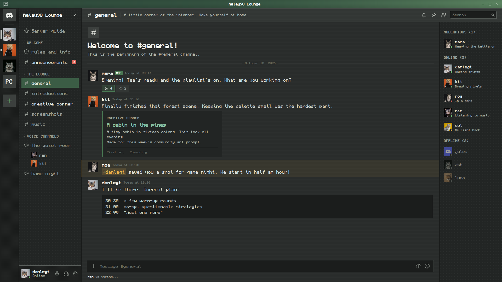
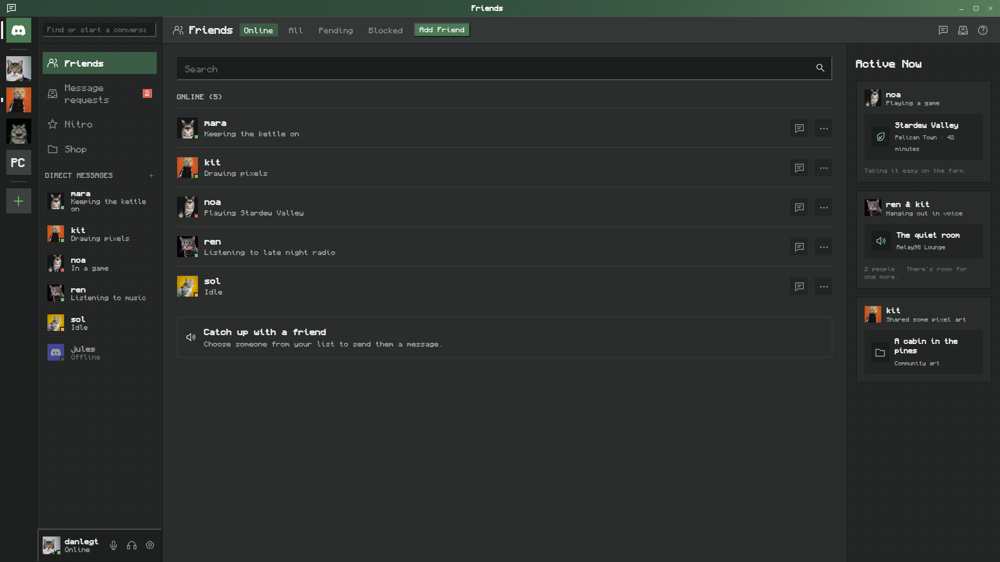
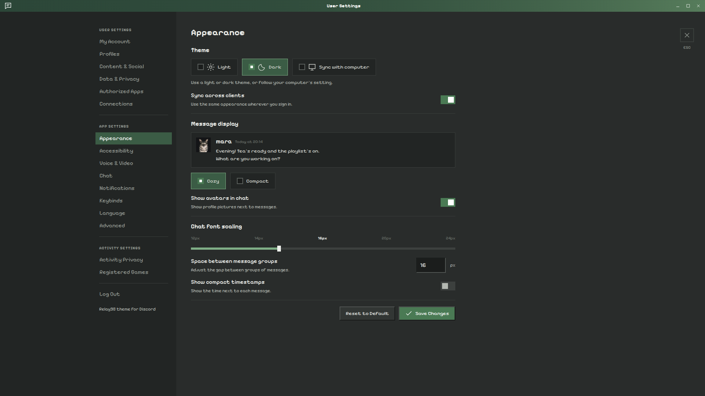

# Relay98

A dark Discord theme for Vesktop and BetterDiscord, with pixel fonts and retro window styling.

The layout takes cues from [system24](https://github.com/refact0r/system24).





## Install

1. Download `relay98.theme.css` from the [latest release](https://github.com/danlegt/Relay98/releases/latest), or build it using the commands below.
2. Copy the file into your themes folder and enable it:
   - Vesktop: Settings → Vesktop Settings → Themes → open the themes folder.
   - BetterDiscord: Settings → Themes → open the themes folder.
3. Reload Discord (Ctrl+R).

## Build

You'll need Node.js 20 or newer and npm. The CSS build has no dependencies to install.

```sh
npm run build   # builds build/relay98.theme.css once
npm run dev     # rebuilds automatically when files in src/ change
```

## Customize your theme

Open [customize.html](customize.html) in your browser from a downloaded or cloned copy of this repo. Keep it beside `customize.css`, `customize.js`, and the `scripts/` and `demos/` folders. You don't need to run a server.

1. Start with Pine, Blue hour, Plum dusk, or Amber terminal. Adjust individual colours if you want a different mix.
2. Set text sizes, message spacing, panel widths, corner radius, and scrollbar width. Choose fonts and turn textures, bevels, or shadows on or off.
3. Copy the build command shown on the page. Open a terminal in the Relay98 folder and paste it there.
4. Install `build/relay98-custom.theme.css` using the steps above. It appears as **Relay98 Custom** in the theme list. Disable the original theme while using it.

The command works in Bash, PowerShell, and Command Prompt. It carries your settings in an encoded argument, so font names and punctuation don't need shell escaping. The page only generates the command; your terminal runs the build. Your source files and `build/relay98.theme.css` stay unchanged.

The preview gives you a quick view of the colours, fonts, and effects. It's a sample conversation, so check the compiled theme in Discord before settling on panel sizes. The page uses the bundled demo fonts and makes no external requests. Custom fonts must be installed on your computer. The Google fonts switch controls whether the compiled theme loads its Pixelify Sans and VT323 fallbacks from Google; it doesn't download other font families.

Your browser remembers the last valid settings when local storage is available. Use the JSON download to keep a copy, and import it later to continue editing. Move the downloaded file into the Relay98 folder to build directly from it:

```sh
npm run build -- --config relay98-settings.json
npm run build -- --config relay98-settings.json --output build/my-theme.theme.css
npm run dev -- --config relay98-settings.json
```

The last command watches both the CSS source and your settings file. A failed rebuild leaves the last successful CSS file in place.

For hand-written settings, omitted fields use their defaults. This example uses the blue palette, larger text, system fonts, and no panel textures or Google font requests:

```json
{
  "palette": "blue",
  "sizes": { "fontSize": 18, "codeSize": 16 },
  "fonts": {
    "ui": "system-ui, Arial, sans-serif",
    "code": "Consolas, monospace"
  },
  "effects": { "textures": false },
  "googleFonts": false
}
```

Colours use six-digit hex values. Sizes use whole pixels within the ranges shown on the page. The build rejects unknown options and invalid values with an error message. Run `npm run build -- --help` for the available command-line options.

## Spotifast theme

Relay98 can also export a matching [Spotifast colour palette](https://spotifast.rocks/settings-and-files/#custom-themes). For the original Pine colours, use [build/relay98.spotifast.json](build/relay98.spotifast.json). For your own colours, open `customize.html` and click **Spotifast theme JSON**. This downloads `relay98-custom.spotifast.json` directly, using the same palette and colour overrides as your Discord theme.

You can also generate the JSON from the command line:

```sh
npm run build -- --format spotifast
npm run build -- --format spotifast --config relay98-settings.json
npm run build -- --format spotifast --config relay98-settings.json --output build/my-spotifast.json
npm run dev -- --format spotifast --config relay98-settings.json
```

The default output is `build/relay98.spotifast.json`, or `build/relay98-custom.spotifast.json` with `--config` or `--custom`. To export the settings from the page's build command, append `--format spotifast` to that command. The settings JSON saved by **Save JSON** is the editable Relay98 configuration. The Spotifast download is the palette you install in the player.

1. In Spotifast, open **Settings > Appearance > Theme** and use **Open themes folder**.
2. Copy the generated `.json` file into that folder as a regular file.
3. Run `spotifast reload-themes` if Spotifast is open, then select the filename in the Theme picker. Linux also detects changes automatically.
4. Turn off **Colour from album art** if you want every page to keep the fixed palette.

The export maps Relay98's surfaces, text, selection, accent, error, and warning colours to Spotifast, with a subtle title-bar-coloured page tint. It chooses the light or dark base from the main background's luminance, and uses the higher-contrast heading or input colour for text on accent buttons. Fonts, sizes, textures, and other Discord effects stay specific to Relay98. Spotifast palettes colour its main window, while its Winamp skins are separate.

## Screenshots

```sh
npm run screenshot
```

The command rebuilds the theme and uses [Playwright and Chromium](https://playwright.dev/docs/library) to take `1920`×`1080` screenshots of the three demo pages. It replaces `assets/chat.png`, `assets/friends.png`, and `assets/settings.png`, the pictures shown above.

Screenshots need Node.js 20 or newer. On the first run, the script downloads Playwright into `demos/node_modules/` and Chromium into `.tools/chromium/`, so you'll need internet access. Git ignores both folders. After setup, screenshots use the cat photos and pixel fonts in this repo without fetching external resources. You can use an existing browser by setting `CHROMIUM_BIN=/path/to/chromium`.

Open `demos/chat.html`, `demos/friends.html`, or `demos/settings.html` to inspect a demo in your browser. They load the built theme automatically; use `?theme=...` to point at another CSS URL. Screenshot scripts can wait for `window.demoReady`. Photo credits are in `demos/images/`, and font licenses are in `demos/fonts/`.

To inspect a custom build in the chat demo, open `demos/chat.html?theme=../build/relay98-custom.theme.css`. The screenshot command always builds and captures the standard theme.

## Checks

```sh
npm test             # build, settings validation, and demo-loader regressions
npm run test:browser  # customizer interactions and compiled CSS in Chromium
```

Browser checks use the same Playwright and Chromium setup as screenshots. They exercise the local page, the generated build command, and the demo pages without replacing the README pictures.

The unit suite includes a Bash command test, so Bash must be available. GitHub Actions runs these checks on Node.js 20 and 24 and checks that the committed CSS and Spotifast JSON match the source. Releases run the unit suite before building both files.

## Structure

```
src/
  00-variables.css   palette + fonts, mapped onto every Discord color token
  10-layout.css      per-area patterns, title bars, panel lines, selection, menus, tooltips
  20-components.css  beveled buttons, sunken inputs, code blocks, scrollbars
scripts/build.js     concatenates src/*.css (in filename order) into build/relay98.theme.css
scripts/customization.js  shared settings, presets, and validation for the page and build
scripts/screenshot.js  optional local screenshot command
scripts/test-browser.js  browser checks for the customizer and demo pages
customize.html       local theme customizer and build-command generator
customize.css        customizer layout and preview styles
customize.js         controls, preview, saved settings, and command copying
build/relay98.theme.css  the actual file you install
build/relay98.spotifast.json  matching Spotifast colour palette
demos/               three static Discord views for screenshots, plus shared layout and loader
assets/              generated 1920 × 1080 PNGs used above
```

To change the defaults in the source, edit the `--r98-*` variables at the top of `src/00-variables.css`. The customizer's presets and allowed settings live in `scripts/customization.js`.

## Fonts

The theme prefers [Monocraft](https://github.com/IdreesInc/Monocraft) for interface text and code when it's installed on your computer. Otherwise, it uses `PixeloidSans` and `PixelOperatorMono` if available, then Google's `Pixelify Sans` and `VT323`. The demos use the same font choices, with bundled copies of the Google fonts for screenshots.

I recommend installing [Monocraft](https://github.com/IdreesInc/Monocraft) as it's a cool font anyway, but you can still have a more than decent experience with the google pixel-art fonts too.

## Discord updates

Like system24 and midnight, the layout rules use Discord's hashed class names, such as `.guilds__5e434`. If Discord renames a class, its layout rule will stop matching. 

Colors still work because they use Discord's CSS variables.

## AI assistance

I originally used this as a sketchy theme that I was basically maintaining along the time, but the theme's colours and styling are completely written by me basically with some AI cleanup.

AI has helped with parts of the theme code, the demo pages and the screenshot tooling.
